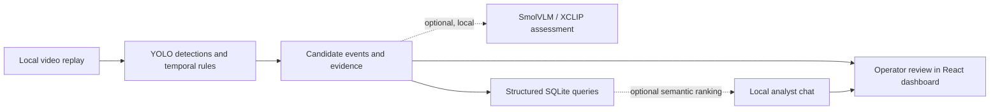

# FrameWitness

**A local-first video incident review desk for finding, investigating, and documenting security events.**

FrameWitness helps security operators review video replays, triage candidate
incidents, and find supporting evidence. It combines a React dashboard with a
FastAPI service, structured event storage, optional local vision models, and a
natural-language query interface. Human review remains the final decision:
model assessments are advisory and do not automatically confirm incidents.

> The service and dashboard are also branded **HackHive Event Desk** in parts of
> the application.

## At a glance



The dashboard shows the event timeline, review state, evidence keyframes/clips,
replay controls, and query results. No screenshot asset is currently included
in the repository; the diagram above summarizes the workflow without implying
model accuracy.

## Built with

| Area | Technology |
| --- | --- |
| API and event processing | Python 3.12, FastAPI, Pydantic, Uvicorn |
| Dashboard | React 19, Vite 7 |
| Event storage | SQLite |
| Video and detection | OpenCV, Ultralytics YOLO; optional Transformers/PyTorch models |
| Tests | pytest, HTTPX |

## Prerequisites

- Windows 10/11, macOS, or Linux.
- Python **3.12**.
- Node.js **20.19+** or **22.12+** and npm (needed for the React dashboard).
- Git.
- For GPU inference: a compatible NVIDIA GPU and the CUDA-enabled PyTorch
  runtime described in [GPU models](#optional-local-models).

The API and dashboard can run in fixture/structured-query mode without model
weights or a GPU. Real detector analysis and the optional model features require
their corresponding local weights.

## Installation

Clone the repository and prepare the Python environment from the project root:

```powershell
git clone https://github.com/aj976/FrameWitness.git
cd FrameWitness

py -3.12 -m venv .venv
.\.venv\Scripts\python.exe -m pip install --upgrade pip
.\.venv\Scripts\python.exe -m pip install -r requirements.txt
```

Install the dashboard dependencies from the project root:

```powershell
Push-Location frontend
npm ci
Pop-Location
```

Start the API from the project root:

```powershell
.\.venv\Scripts\python.exe -m uvicorn backend.main:app --reload
```

Open a second terminal at the project root and start the dashboard:

```powershell
Set-Location frontend
npm run dev
```

Open **http://127.0.0.1:5173**. Vite forwards `/api` requests to the API at
**http://127.0.0.1:8000**. Interactive API documentation is available at
**http://127.0.0.1:8000/docs**. The backend also provides a minimal fixture
dashboard at port 8000.

## Usage

1. Open the dashboard and check the service/model status.
2. Use the deterministic fixture controls to explore the event and review
   workflow without video or model downloads.
3. To analyze a recording, create `recordings\` if needed and put a supported
   video file there (or set `HACKHIVE_RECORDINGS_DIR` to a directory containing
   it), then use the dashboard replay controls. Real detector analysis needs
   YOLO weights; without them, replay is **decode-only** and does not create
   detector incidents.
4. Search events in the analyst query panel. Structured filters and exact
   aggregates are handled by the application; optional local models add
   retrieval-mode routing and semantic ranking.
5. Review candidate events in the dashboard. VLM output is evidence for an
   operator, not a review decision.

The API can also start a replay directly:

```powershell
Invoke-RestMethod -Method Post `
  -Uri http://127.0.0.1:8000/api/replays `
  -ContentType 'application/json' `
  -Body '{"source_name":"demo.mp4","sample_fps":5,"pace":true}'
```

Use `GET /api/replays/{session_id}` to check progress and
`POST /api/replays/{session_id}/stop` to stop a paced replay. The source name
must refer to a file in the configured recordings directory.

Useful API routes include:

- `GET /api/status` — service and optional model readiness.
- `GET /api/events` and `GET /api/events/{event_id}` — incident list and detail.
- `POST /api/events/{event_id}/reviews` — submit a human review.
- `POST /api/query` — structured and optional semantic event search.
- `POST /api/replays` and `GET /api/replays/{session_id}` — replay control/status.
- `POST /api/uploads` — upload a recording.

## Configuration

Configuration is through environment variables; there is no required `.env`
file. Set variables in the same PowerShell session before starting Uvicorn.
Defaults below are relative to the project root.

| Variable | Default | Purpose |
| --- | --- | --- |
| `HACKHIVE_RECORDINGS_DIR` | `recordings` | Directory containing replay source videos. |
| `HACKHIVE_MAX_UPLOAD_MIB` | `250` | Maximum upload size in MiB. |
| `HACKHIVE_DETECTOR_WEIGHTS` | `models/yolo11n.pt` | YOLO detector weights. |
| `HACKHIVE_ACTION_MODEL_DIR` | `models/xclip-base-patch32` | Optional XCLIP action model directory. |
| `HACKHIVE_VLM_VARIANT` | `500m` | SmolVLM variant (`500m` or `2.2b`). |
| `HACKHIVE_VLM_MODEL_DIR` | Variant-specific default | Override the SmolVLM model directory. |
| `HACKHIVE_VLM_SAMPLING` | `swift` | Verification-frame selection (`swift` or `uniform`). |
| `HACKHIVE_CHAT_ENABLED` | `1` | Set to `0` to disable local chat models. Structured queries remain available. |
| `HACKHIVE_CHAT_MODEL_DIR` | `models/qwen3-0.6b` | Optional local query-routing model directory. |
| `HACKHIVE_EMBEDDING_MODEL_DIR` | `models/all-minilm-l6-v2` | Optional local sentence-embedding model directory. |
| `HACKHIVE_CHAT_DEVICE` | `cpu` | Local chat inference device (`cpu` or `cuda`). |

For example, point the service at another recordings folder before startup:

```powershell
$env:HACKHIVE_RECORDINGS_DIR = 'D:\CCTV\review-queue'
.\.venv\Scripts\python.exe -m uvicorn backend.main:app --reload
```

Application state, SQLite data, uploaded recordings, and generated media are
stored locally under `data\` and `recordings\` by default. Do not commit private
footage, generated event media, local databases, or downloaded model weights.

## Optional local models

The basic install supports deterministic fixtures and structured event search.
Models are optional, downloaded separately, and run locally; the application
does not use hosted inference as a fallback.

### Real-video person detection

Install the detector dependency (included in `requirements.txt`) and download
YOLO11n once while online:

```powershell
.\.venv\Scripts\python.exe -c "from ultralytics import YOLO; YOLO('models/yolo11n.pt')"
```

### Analyst chat and semantic retrieval

Install the GPU/model dependencies, download the pinned local models, and run
the CPU smoke test:

```powershell
.\.venv\Scripts\python.exe -m pip install -r requirements-gpu.txt
.\.venv\Scripts\python.exe scripts\setup_chat_models.py --download
.\.venv\Scripts\python.exe scripts\setup_chat_models.py --smoke --device cpu
```

Chat defaults to CPU so it does not compete with video models for GPU memory.
The structured parser and SQLite query path remain available when models are
disabled or not installed. Semantic ranking searches at most the 100 newest
structured candidates; the API reports that bounded candidate scan separately
from exact structured totals.

### Optional video action ranking and VLM verification

Download the XCLIP action model for additional reviewable action candidates:

```powershell
.\.venv\Scripts\python.exe -m pip install -r requirements-gpu.txt
.\.venv\Scripts\python.exe scripts\download_action_model.py
```

SmolVLM verification is also optional and requires its model assets. See
[`scripts\smoke_vlm.py`](scripts/smoke_vlm.py) and the script help for hardware
checks, one-time downloads, and local inference examples. The application
defaults to the 500M variant. The 2.2B variant is selectable but is not claimed
to fit every laptop GPU.

## Development and evaluation

Run the test suite from the repository root:

```powershell
.\.venv\Scripts\python.exe -m pytest -q
```

Build the dashboard:

```powershell
npm --prefix frontend run build
```

Evaluation and data-preparation scripts live in `scripts\`:

- `label_videos.py` creates a source-separated JSONL labeling manifest.
- `validate_manifest.py` checks dataset manifests before evaluation.
- `evaluate.py` scores frozen predictions against labels.
- `evaluate_chat.py` evaluates labeled query/retrieval cases.

For example, label and validate videos you have permission to use:

```powershell
.\.venv\Scripts\python.exe scripts\label_videos.py `
  --videos recordings `
  --output evaluation\sample_manifest.jsonl
.\.venv\Scripts\python.exe scripts\validate_manifest.py evaluation\sample_manifest.jsonl
```

Keep all windows from a source in the same dataset split. Do not treat
unreviewed or provisional labels as ground truth, and do not report accuracy
until labels and a held-out evaluation set have been verified.

## Current limitations and safety notes

- All generated candidates remain unreviewed until a human operator acts.
  VLM verdicts are advisory; they never automatically confirm an incident.
- Real detector replay needs local weights. Without them, the API reports
  `decode_only` rather than inventing incidents.
- The integrated candidate path covers person-down, crowd-gathering,
  suspected-tailgating, and optional XCLIP aggression candidates.
  Fire/smoke and restricted-area intrusion are experimental and do not yet have
  production candidate generators.
- Model scores are uncalibrated. Supplied sample clips and pilot reports are not
  a labeled, held-out accuracy benchmark and do not establish deployment
  readiness.
- Configure camera geometry and policy before interpreting crowd or tailgating
  candidates. Verify the source footage, timestamps, permissions, and labels
  before using it for evaluation.
- This project is a local review prototype, not a substitute for operator
  judgment or a validated production surveillance system.

## Project layout

```text
backend/       FastAPI service, query logic, replay, inference, and storage
frontend/      React dashboard and Vite configuration
scripts/       Model setup, replay smoke tests, labeling, and evaluation
tests/         Backend, inference-contract, and evaluation tests
evaluation/    Query cases and dataset manifests
requirements.txt
requirements-gpu.txt
```
